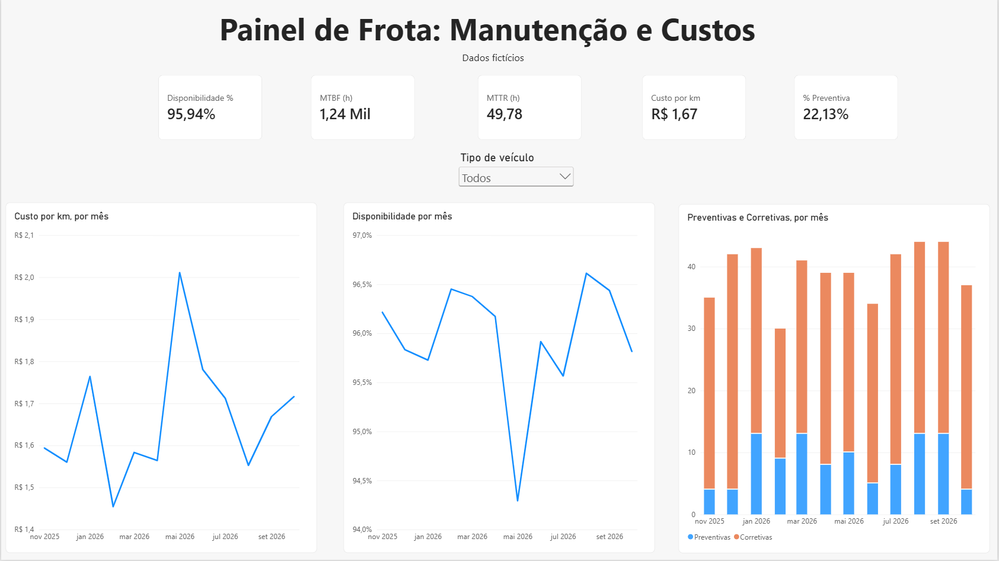

# Painel de Frota: Manutenção e Custos

> **Atenção: todos os dados deste projeto são fictícios.** Foram gerados por script para simular a rotina de uma área de frota. Não representam nenhuma empresa real.

Projeto de portfólio em **Power BI** que simula o trabalho de um(a) analista de dados de frota: acompanhar manutenções preventivas e corretivas, monitorar indicadores de disponibilidade e custo, identificar veículos problemáticos e controlar vencimentos de documentos.



**[Abrir o painel em PDF](docs/painel_frota.pdf)** · [Arquivo do Power BI](powerbi/painel_frota.pbix) · [Guia de montagem](docs/guia-power-bi.md)

## Perguntas que o painel responde

1. **Visão geral:** a frota está disponível? Quanto custa rodar cada km? A manutenção é planejada ou reativa?
2. **Custos e recorrência:** quais sistemas mais falham? Quais veículos concentram o custo e repetem a mesma falha?
3. **Vencimentos e oficinas:** quais licenciamentos, seguros e inspeções já venceram ou vencem em 30 dias? Quanto cada oficina custa e quanto tempo deixa o veículo parado?

## Principais conclusões (sobre os dados fictícios)

- Disponibilidade de **95,94%**, MTBF de **1.240 h**, MTTR de **49,8 h** e custo de **R$ 1,67 por km** (manutenção + combustível).
- **77,9%** das ordens de serviço são corretivas: a manutenção é reativa. Só 22,1% são preventivas.
- **4 veículos antigos (fabricados em 2013 e 2014) concentram 24,6%** do custo de manutenção. São candidatos a renovação ou descarte. O mais caro custa R$ 3,26 por km.
- Motor (76 falhas) e freios (70) lideram as corretivas. Motor e transmissão pesam mais no custo e no tempo de parada.
- A oficina diesel concentra cerca de 45% do custo de manutenção.
- **25 documentos já estão vencidos** e 34 vencem em até 30 dias, o que representa risco de multa e de seguro sem cobertura.

## Indicadores

| Indicador | Definição |
|---|---|
| Disponibilidade | 1 menos (horas de veículo parado ÷ horas do calendário da frota) |
| MTBF | horas em operação ÷ número de manutenções corretivas |
| MTTR | média de horas paradas por manutenção corretiva |
| Custo por km | (peças + mão de obra + combustível) ÷ km rodados |
| % Preventiva | ordens de serviço preventivas ÷ total de ordens de serviço |
| Dias para vencer | data de vencimento do documento menos a data de hoje |

## Modelo de dados

Modelo em estrela, com relações um-para-muitos e filtro em uma direção.

- **Dimensões:** `dim_veiculo`, `dim_oficina`, `dim_calendario`.
- **Fatos:** `fato_manutencao`, `fato_abastecimento`, `fato_km_mensal`, `fato_vencimento`.
- `dim_veiculo[id_veiculo]` liga a todos os fatos. `dim_oficina[id_oficina]` liga a `fato_manutencao`. `dim_calendario[data]` liga a `fato_manutencao[data_abertura]`, `fato_abastecimento[data]` e `fato_km_mensal[mes]`.

As medidas DAX e o passo a passo estão em [`docs/guia-power-bi.md`](docs/guia-power-bi.md).

## Estrutura do repositório

```
dados/     CSVs fictícios (54 veículos, 470 ordens de serviço, nov/2025 a out/2026)
codigo/    gera_frota.py (gera os dados) e kpis.py (confere os totais em Python)
powerbi/   painel_frota.pbix
docs/      painel_frota.pdf (as 3 páginas), painel_frota_pagina1.png e guia-power-bi.md (medidas DAX e montagem)
```

## Como reproduzir

1. Para gerar os dados de novo: `python codigo/gera_frota.py dados` (a semente é fixa, então o resultado é sempre o mesmo).
2. Para conferir os totais em Python: `python codigo/kpis.py dados kpis.json` (requer `pandas`).
3. Abra `powerbi/painel_frota.pbix` no Power BI Desktop.

## Ferramentas

Power BI Desktop (Power Query, modelagem, DAX) e Python (pandas) para geração e conferência dos dados.

## Limitações

- Os dados são sintéticos e não refletem uma operação real.
- A disponibilidade usa as horas de calendário (24 h por dia) como base.
- A coluna `Dias para Vencer` usa `TODAY()`, então os vencimentos mudam conforme a data em que o arquivo é aberto. A base foi montada tendo 17/11/2026 como referência.

## Autoria

Patrícia Falchi, em transição de carreira da área jurídica para análise de dados.
